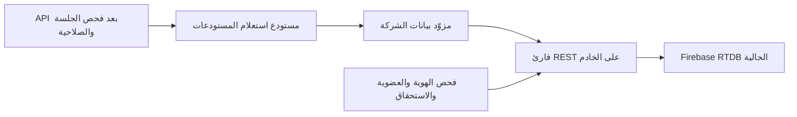

# الدفعة الرابعة: مزوّد بيانات الشركة وقراءات موثوقة للهوية

هذه الوثيقة تسجل دفعة القراءات تاريخياً. استُكملت كتابة المستودعات والسيارات الإدارية محلياً في [الدفعة الخامسة](warehouse-writes.ar.md)، وتوثق الأخيرة النتائج الحالية وما بقي من تحقق وتشغيل.

نُفذت هذه الدفعة محلياً في المرحلة 3. تستخدم القاعدة المشتركة ومسارات الشركات الحالية، ولا تنقل أو تعيد تسمية سجلات أو مخازن. فُحص عقد الواجهة في `inventoryDaher/src/services/warehouse.ts`؛ لم يحتج تعديلاً لأن استجابة القائمة بقيت كما هي.

## ما نُفذ

### سياق الشركة وتوجيه البيانات

`resolveActiveTenant()` لا يأخذ رمز شركة أو رابط قاعدة من الطلب. يقرأ سياق الشركة الذي أنشأه فحص العضوية في AsyncLocalStorage، ويعيد توصيفاً ثابتاً: الشركة، و`databaseKey=shared`، ومسارها تحت `TENANTS_ROOT`. لا توجد وجهة مخصصة قابلة للتفعيل في هذه الدفعة ولا جدول توجيه يستطيع مدير الشركة تعديله.

`getTenantDatabase()` ينشئ قارئاً مقيداً بهذه الشركة. يفحص السياق عند كل قراءة وبعدها، ويرفض استخدام مرجع شركة A داخل سياق B أو خارج سياق شركة. يرفض المسارات المطلقة والفارغة ومفاتيح Firebase غير الصالحة، ولا يفتح جذور `control` أو `users` أو الشركات الأخرى. إعداد قاعدة البيانات من متغيرات الخادم فقط؛ حقول `tenantId` و`databaseUrl` في query لا تغير الوجهة.

هذه هي نقطة التوسعة المستقبلية لقاعدة مخصصة: إضافة وجهة موثوقة في إعداد الخادم ثم استخدامها داخل المزوّد، بعد النسخ والتحقق والاختبارات. لا نضيف شروطاً بأسماء العملاء داخل المتحكمات.

### مستودع استعلام المستودعات

نُقلت ثلاثة استعلامات في `warehouses.controller.ts` إلى `warehouses.repository.ts`:

- قائمة HTTP: `GET /api/warehouses`.
- القائمة الداخلية: `getAllWarehousesInternal()`.
- السجل بالمعرف: `getWarehouseByIdInternal()`.

تعيد القائمة `Object.values` كما في العقد السابق، دون فرض ترتيب جديد أو إسقاط الحقول أو تغيير المعرفات أو استبعاد المستودعات المعطلة والسيارات. عدم وجود المجموعة يرجع `[]`، وعدم وجود السجل يرجع `null`. تُحفظ الحقول غير المعروفة. فشل القراءة لا يظهر كقائمة فارغة؛ HTTP يرجع `503 WAREHOUSE_READ_UNAVAILABLE` دون تفاصيل الاتصال.

عمليات الإنشاء والتعديل والحذف والقراءات التابعة لكتاباتها باقية في المسار الحالي؛ لم تُحوّل هذه الأوامر إلى المزوّد الجديد. اختُبر أن إنشاء مستودع بالطريقة القائمة ثم قراءته بالطريقة الجديدة يُظهر نفس المعرف والبيانات، دون نقل السجلات السابقة.

## معالجة حداثة الهوية والصلاحيات

كانت `auth/accounts.readObject()` تعتمد على `get()` في Firebase JavaScript SDK. توضح [وثائق Firebase](https://firebase.google.com/docs/database/web/read-and-write#read_data_once) أن القراءة قد تستخدم ذاكرة العميل إذا تعذر الحصول على قيمة من الخادم. هذا لا يناسب قرار السماح المبني على عضوية يمكن إلغاؤها.

صارت كل استدعاءات `readObject()` تستخدم GET مباشر من REST، ويشمل ذلك:

- ملفات المستخدمين القديمة، وهوية `control` وعضويتها.
- حالة الشركة وانتهاء التجربة.
- استحقاق AI، وقراءات إدارة المستخدمين ذات الصلة.

لا يوجد رجوع إلى SDK أو قيمة محلية سابقة عند الفشل. القراءة تطلب `no-store`، وترفض إعادة التوجيه وردود غير 200 والرد غير الصالح. تفشل قرارات التحقق بـ `503 AUTH_UNAVAILABLE` عند تعذر القراءة، مع بقاء رموز رفض العضوية أو الشركة القائمة عند ورود سجل حديث يمنع الوصول. تستفيد حراسة HTTP وSocket من نفس المسار؛ سحب العضوية أو تعذر قراءتها يمنع حزمة المسودة التالية، ويُفحص المتلقون قبل البث كما في الدفعة السابقة.

لا يعني ذلك إلغاء عملية بدأت قبل سحب الصلاحية، أو فصل Socket خامل فوراً دون حزمة/بث؛ هذا يحتاج آلية إشعار مستقلة إذا تطلبته سياسة المنتج. المقصود أن فحص السماح الجديد لا يُنجز من نسخة SDK مخبأة. القراءات ليست لقطة ذرية واحدة لكل ملفات الهوية والشركة؛ القراءات المستقلة للهويّة والعضوية تُنفذ بالتوازي لتقليل الزمن.

### النقل والمصادقة

يستخدم قارئ REST مهلة 8 ثوان لكل نداء، تشمل انتظار اعتماد الخادم وتنزيل الرد. الحد الأقصى للرد 16 MiB، ويُفحص عدد البايتات أثناء التنزيل أيضاً. قد يتضمن طلب API عدة نداءات؛ ليست هذه مهلة 8 ثوان للطلب الكامل. لا تُعرض روابط القاعدة أو ردود الأخطاء الخام أو تفاصيل الاعتماد في خطأ العميل.

في الإنتاج تستخدم الطلبات OAuth2 من Application Default Credentials عبر `google-auth-library@11.3.1`. يُرسل الرمز في ترويسة Authorization، ولا يوضع في الرابط. تؤكد [وثائق Firebase للمصادقة على REST](https://firebase.google.com/docs/database/rest/auth) دعم هذا المسار ونطاقي `firebase.database` و`userinfo.email`. تُجمع طلبات الحصول على الرمز الجارية في طلب واحد؛ تخزين مكتبة Google لرمز الاتصال لا يعني تخزين العضويات أو نتائج قراءتها.

## إعداد التشغيل الجديد

متطلبات الخادم:

| الإعداد | القيمة أو المعنى |
| --- | --- |
| Node | `>=22.19.0`، مطابق لنسخة الاختبار وCI الحالية |
| `NODE_ENV` | `production` على خادم الإنتاج |
| `JWT_SECRET` | السر العشوائي القوي الموثق سابقاً |
| `FIREBASE_databaseURL` | رابط أصل RTDB الحالية، دون مسار أو معاملات أو أسرار |
| `FIREBASE_REST_AUTH_MODE` | `google` في الإنتاج؛ وهو الافتراضي عند `NODE_ENV=production` |
| ADC | هوية استضافة مدعومة أو اعتماد خادم مركب عبر `GOOGLE_APPLICATION_CREDENTIALS` |

تشرح [وثائق Google حول ADC](https://cloud.google.com/docs/authentication/application-default-credentials) مصادر الاعتماد. إذا استُخدم ملف حساب خدمة، يكون خارج المستودع والواجهة، في مخزن أسرار الخادم أو ملف مركب آمن. لم يُنشأ أو يُقرأ ملف اعتماد حقيقي في هذه الدفعة، ولم تُعدّل `.env`.

يتحقق الإقلاع من أصل Firebase ومن وضع المصادقة قبل تحميل التطبيق. يقبل عناوين Firebase الرسمية بـ HTTPS، ويرفض قاعدة خارجية أو عنواناً يحمل اعتماداً في الرابط. وضع `anonymous` مرفوض عند `NODE_ENV=production`. في التطوير يبقى الافتراضي `anonymous` للتوافق مع طريقة وصول SDK الحالية؛ هذا لا يتجاوز القواعد ولا يفتحها، وسيرفض Firebase القراءة إذا لم تسمح بها. يمكن ضبط `google` للتطوير أيضاً بعد إعداد اعتماد منفصل لبيئة الاختبار.

الحصول الفعلي على اعتماد Google كسول عند الطلب؛ فشل الحصول عليه يؤدي إلى 503 دون إعادة محاولة مجهولة الهوية. استجابة الصحة `/` تبقى فحص تشغيل للعملية، ولا تثبت جاهزية اعتماد القاعدة.

**متطلب نشر مهم:** لا تغيّر قواعد Firebase الآن استناداً إلى هذا القارئ وحده. بقية قراءات وكتابات الأعمال ما زالت تستخدم SDK العميل وطريقة وصوله الحالية. يجب تخطيط اعتماد الكتابات ونقلها واختبارها قبل تشديد قواعدها؛ وجود قارئ خادم موثق لا يؤمّن الكتابات القديمة تلقائياً. قواعد الهوية والأعمال المنشورة، وIAM لحساب الخدمة، والنسخ والاستعادة تظل بوابات staging والإنتاج.

## الملفات

| الملف | المسؤولية |
| --- | --- |
| `src/tenancy/tenantResolver.ts` | استخراج توصيف الشركة من السياق الموثوق |
| `src/tenancy/tenantDatabaseProvider.ts` | ربط القراءة بالشركة ومنع تبديل السياق والمسارات المحجوزة |
| `src/tenancy/databasePath.ts` | فحص المفاتيح قبل ترميز الرابط |
| `src/repositories/warehouses.repository.ts` | استعلام القائمة والسجل، مع حفظ عقد البيانات |
| `src/infrastructure/serverDatabase.ts` | GET مباشر ومحدود الحجم والمهلة دون ذاكرة نتائج |
| `src/infrastructure/serverCredentials.ts` | OAuth2 من ADC، وفصل الاعتماد عن المتحكمات |
| `src/config/serverDatabase.ts`, `src/config/runtime.ts` | التحقق من إعداد الوجهة ووضع الإنتاج |
| `src/auth/accounts.ts` | نقل قراءات الهوية والإدارة إلى قارئ الخادم |
| `src/controllers/warehouses.controller.ts` | استدعاء المستودع للقراءات الثلاث |
| `package.json`, `package-lock.json` | اعتماد Google ونسخة Node المطلوبة |
| `scripts/audit-source.cjs` | جرد مواضع `server-rest` واعتمادات قارئ الخادم |
| `tests/server-database.test.js` | الاتصال والمهلة والحجم والترميز والاعتماد |
| `tests/warehouse-provider.test.js` | العقد والعزل والتداخل وفشل الاتصال في HTTP وSocket |
| اختبارات الهوية والجرد والإقلاع ومساعد الذاكرة | تثبيت الحد الفاصل الجديد ومنع استدعاء الشبكة الحقيقية في اختبارات الأعمال |

## التحقق والحدود

- `npm test` في الخادم: **90 اختباراً ناجحاً**، ويشمل بناء TypeScript.
- `npm test` في الواجهة: **21 اختباراً ناجحاً**. لم تتغير شيفرة الواجهة في هذه الدفعة، ولم يُعَد فحص TypeScript الكامل أو بناء Vite فيها؛ أخطاء الأنواع السابقة موثقة في تقرير الدفعة الثالثة.
- جرد المصدر: 88 ملف TypeScript في الخادم و93 إعلان API، وموضعا قراءة REST مباشران في الهوية والمزوّد. اختبارات الحدود تمنع استيراد القارئ المباشر أو اعتماد Google داخل متحكمات الأعمال.
- اختُبرت القراءة عبر HTTP فعلي على loopback: اتصال ناجح ثم قطع الاتصال، ردود رفض وخطأ وتحويل، انقطاع أثناء انتظار الرد، جسم متوقف، حجم زائد، JSON غير صالح، وتعذر الاعتماد. لم يجر اتصال بقاعدة حية أو بخدمة Google للحصول على رمز حقيقي؛ اختبار محول Google يستبدل دالة الحصول على الرمز فقط.
- اختُبرت استجابة API للشركتين والتداخل الزمني بينهما، وفشل محاولة اختيار وجهة من query، وحفظ المعرفات والحقول والسجلات المعطلة، ورفض استخدام قارئ A داخل B. اختُبر رفض الدخول وHTTP وSocket أثناء فشل اتصال مخزن الهوية، وسحب عضوية مركزية واستحقاق شركة.

خادم HTTP الاختباري ليس Firebase Emulator، ولا يحاكي Security Rules أو IAM أو معاملات RTDB المتنافسة. يثبت سلوك النقل الجديد عند الأعطال ومنع الرجوع إلى ذاكرة SDK، ولا يغني عن اختبار الوصول إلى Firebase الفعلية في staging بحساب خدمة محدود.

التحقق الحالي يزيد عدد نداءات REST لكل طلب محمي؛ المستخدم المركزي يحتاج قراءات ملفه وهويته وعضويته وحالة الشركة والتجربة. يلزم قياس زمنها وتكلفتها تحت الحمل قبل التوسع. لا نعيد ذاكرة سماح عامة لتقليل النداءات؛ يمكن لاحقاً تحسين مخطط الهوية أو بروتوكول الإلغاء مع اختبارات واضحة. سقف 16 MiB رفض للقراءة الكبيرة، وليس بديلاً عن التقسيم إلى صفحات في المجموعات الكبيرة.

## الطرح والتراجع والعمل التالي

1. تجهيز قاعدة staging ونسخة قابلة للاستعادة، ثم ضبط اعتماد Google ورابط نفس القاعدة المستخدمة في SDK. لا تجمع قارئاً من بيئة وكتابات من بيئة أخرى.
2. تجربة الدخول بجميع صيغ الحسابات، والقائمة والبيع والقبض وإنشاء مستودع ثم قراءته، ومقارنة البيانات قبل التجربة وبعدها. قطع اتصال القراءة والتحقق من 503 ومنع Socket، ثم استعادته.
3. مراجعة قواعد RTDB وIAM، وخطة نقل اعتماد الكتابات، ومعالجة أخطاء الأنواع السابقة في الواجهة قبل بوابة نشر تعتمد عليها. لا تنشر تغييرات قواعد تعطل مسار SDK القائم.
4. عند تعثر الطرح، أوقف التوسعة أو استخدم بناء توافق يحافظ على قراءة الهوية المباشرة وحدود الشركات. لا يُستخدم الرجوع إلى ذاكرة الهوية كحل لانقطاع القاعدة. لا تحتاج هذه الدفعة استرجاع بيانات لأنها لا تنقل أو تعدل بيانات إنتاج.

استُكملت أوامر كتابة وحدة المستودعات والسيارات الإدارية لاحقاً في `warehouse-writes.ar.md`. العمل التالي: إتمام اختبار المحاكي وبيئة staging ثم توسيع النمط لوحدات أخرى. وتبقى مرحلة منع تكرار البيع والقبض وثبات المحاسبة شرطاً قبل البيع التجاري واسع النطاق. قاعدة مخصصة لكل شركة والتخصيصات عبر إعدادات واستحقاقات تأتي ضمن المراحل الموثقة؛ لم تُفعّل هنا.
